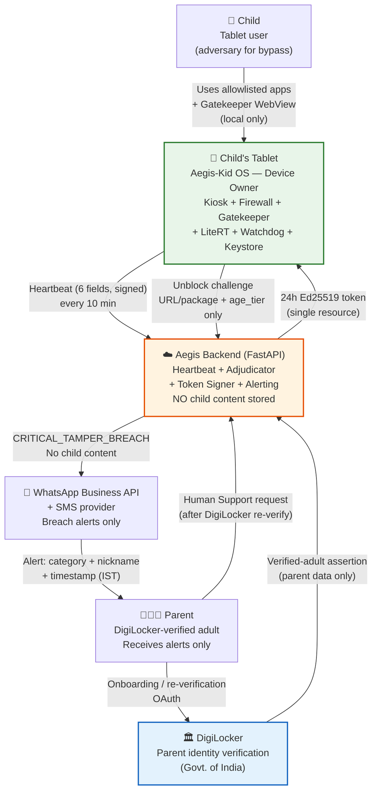
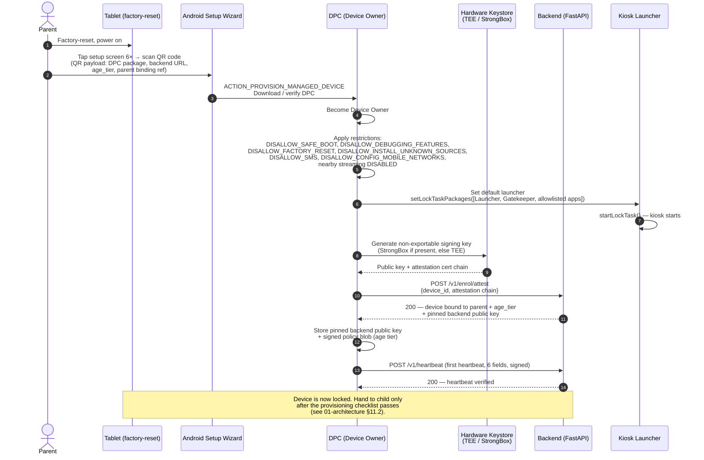
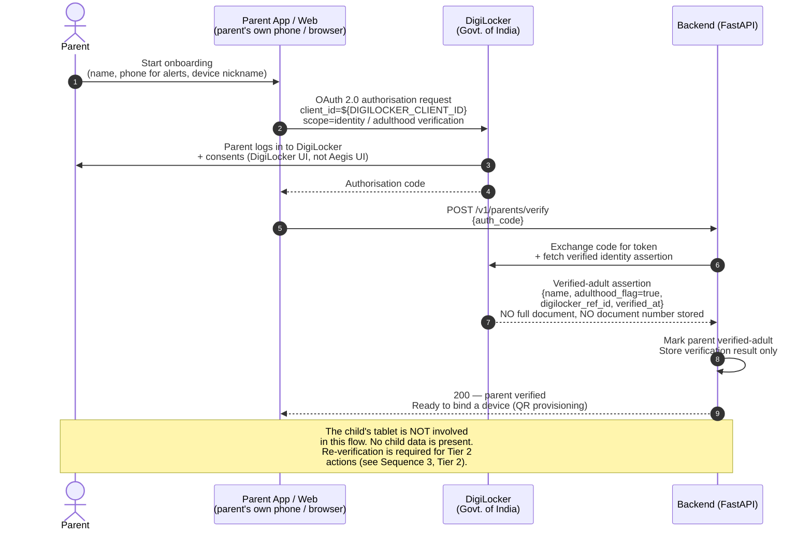
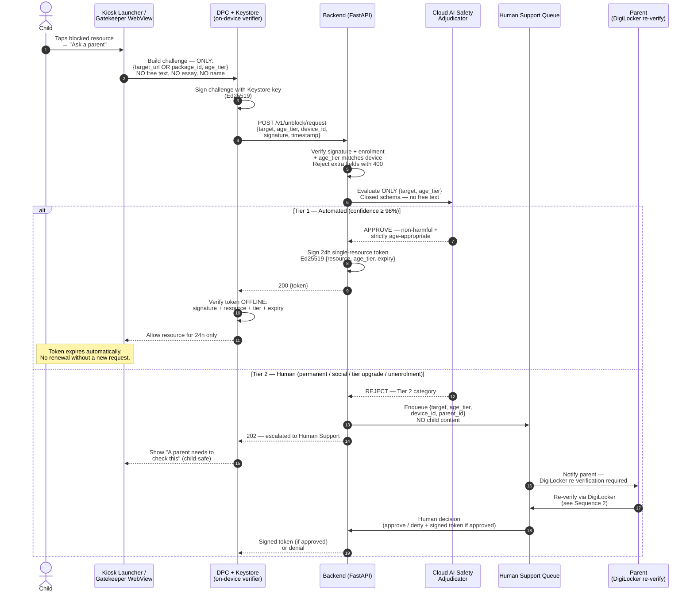
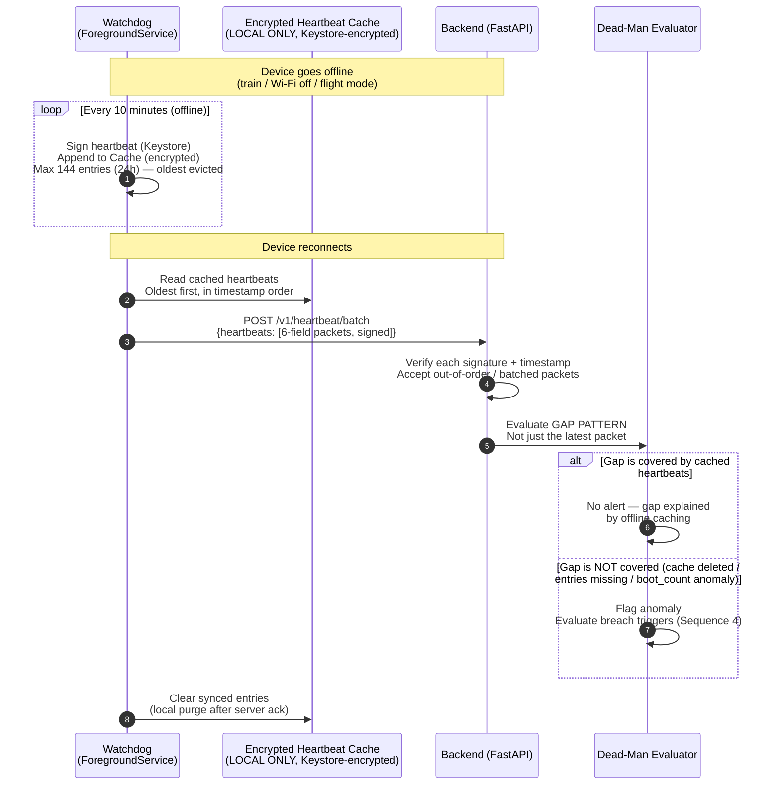

# Aegis-Kid OS (India Edition) — Data-Flow Diagrams

| Field | Value |
|---|---|
| Document | `docs/data-flow-diagram.md` |
| Version | 1.0.0 — MVP |
| Date | 2026-11-25 |
| Status | **Canonical, embeddable Mermaid source** — copy any diagram block into the repo README, the parent dashboard, or a DPDP review pack without editing |
| Companion docs | `docs/01-architecture-threat-model.md` (§5–§6), `docs/age-tier-policies.md`, `docs/dpdp-compliance-checklist.md` |
| How to read | Every diagram is Mermaid. Every arrow is labelled with the *exact* fields that cross it. Every store is labelled `LOCAL ONLY` or `BACKEND — NO CHILD CONTENT`. If an arrow or a store is not in these diagrams, it does not exist in the MVP. |

> **Proof statement:** These diagrams prove zero child PII leaves the device *by construction*. There is no arrow that carries browsing history, app usage logs, screenshots, search queries, or voice/text inputs out of the tablet. The only arrows that leave the tablet are (1) the heartbeat, (2) the unblock challenge, and (3) the one-time attestation at provisioning — all in the exact schemas in §2. Parent DigiLocker data flows parent → DigiLocker → backend, never through the child's device, and never contains child data.

---

## 1. System Context (Level 0)



**Reading note:** The child never talks to the backend directly except through the two signed, schema-closed channels (heartbeat, unblock challenge). The parent never talks to the child's tablet. The backend never talks to the child except by returning a signed token to the device.

---

## 2. Data-Flow Diagram (Level 1) — The Zero-PII Proof

This is the diagram a DPDP reviewer should start from. Every data store and every flow is labelled.

```mermaid
flowchart TB
    subgraph Tablet["📱 TABLET — TRUSTED ZONE (Device Owner)"]
        direction TB
        Launcher["C2 Kiosk Launcher<br/>(LockTask)<br/>Allowlisted apps only"]
        DPC["C1 DPC<br/>DevicePolicyManager<br/>Signed policy store<br/>LOCAL ONLY"]
        VPN["C3 VpnService Firewall<br/>DNS / SNI filtering<br/>Always-on, fail-closed"]
        WebView["C4 Gatekeeper WebView<br/>Only browser<br/>Content interceptor"]
        LiteRT["C5 LiteRT Classifier<br/>Quantized int8, &lt;300 MB<br/>VOLATILE RAM ONLY"]
        OCR["C6 OCR Screen-Guard<br/>Low-power sampling<br/>VOLATILE RAM ONLY"]
        Keystore["C7 Hardware Keystore<br/>TEE / StrongBox<br/>Non-exportable key<br/>LOCAL ONLY — key never leaves"]
        Watchdog["C8 Watchdog<br/>ForegroundService + WorkManager<br/>Encrypted heartbeat cache<br/>LOCAL ONLY"]
        EdTech["Allowlisted EdTech Apps<br/>PW, DIKSHA, Khan, Unacademy,<br/>BYJU'S/Aakash, YouTube Kids<br/>Signature-verified"]
        PolicyStore[("Signed Policy Blob<br/>LOCAL ONLY<br/>Ed25519-verified")]
        HeartbeatCache[("Encrypted Heartbeat Cache<br/>LOCAL ONLY<br/>Keystore-encrypted")]
    end

    subgraph Backend["☁️ BACKEND (FastAPI) — UNTRUSTED FOR CHILD DATA"]
        direction TB
        HBIntake["Heartbeat Intake<br/>/v1/heartbeat"]
        DeadMan["Dead-Man Evaluator<br/>Battery / gap / attestation logic"]
        Adjudicator["Cloud AI Safety Adjudicator<br/>Input: URL/package + age_tier ONLY<br/>≥98% auto-approve"]
        TokenSigner["Ed25519 Token Signer<br/>24h, single-resource tokens"]
        HumanQueue["Human Support Queue<br/>Tier 2: permanent / social /<br/>tier upgrade / unenrolment"]
        DigiLockerSvc["DigiLocker Verification<br/>Parent only"]
        Alerting["Alerting<br/>WhatsApp Business + SMS"]
        HBStore[("heartbeats<br/>6 fields only<br/>NO child content")]
        TokenStore[("tokens<br/>resource + tier + expiry<br/>NO child content")]
        ParentStore[("parents<br/>DigiLocker-verified<br/>PARENT data only")]
    end

    DigiLockerExt["🏛️ DigiLocker<br/>(external)"]
    ParentPhone["📞 Parent's Phone<br/>WhatsApp / SMS"]

    %% --- Local-only flows (never leave the tablet) ---
    Launcher -->|"Launch allowlisted app<br/>(package ID, local)"| EdTech
    Launcher -->|"Open URL<br/>(local intent)"| WebView
    WebView -->|"Page text / image (RAM)<br/>PURGE AFTER VERDICT"| LiteRT
    OCR -->|"OCR text (RAM)<br/>PURGE AFTER VERDICT"| LiteRT
    LiteRT -->|"Verdict: allow / block<br/>(RAM only)"| WebView
    WebView -->|"DNS / SNI query"| VPN
    EdTech -->|"DNS / SNI query<br/>(CDN allowlist check)"| VPN
    VPN -->|"Allow / block<br/>(DNS/SNI only, no DPI for DRM)"| EdTech
    DPC -->|"Apply restrictions<br/>Re-assert on boot"| Launcher
    DPC -->|"Set always-on VPN"| VPN
    PolicyStore -->|"Signed policy<br/>(age tier, allowlist, CDN list)"| DPC
    PolicyStore -->|"Signed policy<br/>(rubrics)"| LiteRT
    Keystore -->|"Sign heartbeat<br/>(private key never leaves TEE)"| Watchdog
    Keystore -->|"Verify token / policy<br/>(pinned backend public key)"| DPC

    %% --- Flows that MAY leave the tablet (exhaustive) ---
    Watchdog -->|"① HEARTBEAT — every 10 min<br/>device_id, keystore_signature,<br/>battery_pct, network_state,<br/>boot_count, timestamp"| HBIntake
    Watchdog -.->|"①b OFFLINE: cache locally<br/>in HeartbeatCache,<br/>batch-sync on reconnect"| HeartbeatCache
    HeartbeatCache -.->|"①c Batch-sync<br/>(same 6 fields, in order)"| HBIntake
    Launcher -->|"② UNBLOCK CHALLENGE<br/>target_url OR package_id,<br/>age_tier, device_id, signature,<br/>timestamp — NO free text"| Adjudicator
    TokenSigner -->|"②b 24h Ed25519 token<br/>resource + tier + expiry"| DPC
    Keystore -.->|"③ ATTESTATION (once, at provisioning)<br/>Attestation cert chain only"| HBIntake

    %% --- Backend-internal flows ---
    HBIntake -->|"Store 6 fields"| HBStore
    HBIntake -->|"Evaluate"| DeadMan
    DeadMan -->|"CRITICAL_TAMPER_BREACH"| Alerting
    Adjudicator -->|"≥98%: auto-approve"| TokenSigner
    Adjudicator -->|"Tier 2: escalate"| HumanQueue
    TokenSigner -->|"Store token record"| TokenStore
    HumanQueue -->|"After DigiLocker re-verify"| TokenSigner

    %% --- Parent flows (no child data) ---
    DigiLockerExt -->|"Verified-adult assertion<br/>(parent data only)"| DigiLockerSvc
    DigiLockerSvc -->|"Store verification result"| ParentStore
    Alerting -->|"Breach alert<br/>Category + nickname + time<br/>NO child content"| ParentPhone

    style LiteRT fill:#fce4ec,stroke:#c62828,stroke-width:2px
    style OCR fill:#fce4ec,stroke:#c62828,stroke-width:2px
    style Keystore fill:#e8f5e9,stroke:#2e7d32,stroke-width:2px
    style PolicyStore fill:#fff8e1,stroke:#f57f17,stroke-width:2px
    style HeartbeatCache fill:#fff8e1,stroke:#f57f17,stroke-width:2px
    style HBStore fill:#fff3e0,stroke:#e65100,stroke-width:2px
```



### 2.1 What MAY leave the device — exhaustive table

| # | Flow | Endpoint | Exact fields | Frequency / trigger | Child PII? |
|---|---|---|---|---|---|
| ① | Heartbeat | `POST /v1/heartbeat` | `device_id`, `keystore_signature`, `battery_pct`, `network_state`, `boot_count`, `timestamp` | Every 10 min, or batched on reconnect | **No** — see §2.2 |
| ② | Unblock challenge | `POST /v1/unblock/request` | `target_url` **or** `package_id`, `age_tier`, `device_id`, `keystore_signature`, `timestamp` | Only when the child taps "Ask a parent" on a blocked resource | **No** — a URL/package ID + tier is not PII; no free text, no name, no history |
| ③ | Attestation | `POST /v1/enrol/attest` | Keystore attestation certificate chain, `device_id` | Once, at provisioning | **No** — proves the hardware key, not the child |
| ④ | Parent DigiLocker verification | DigiLocker → `POST /v1/parents/verify` (backend) | Parent identity assertion (name, adulthood flag, DigiLocker reference ID) | Parent onboarding / re-verification | **Parent data only** — never child data, never via the child's device |
| — | Anonymous counters (optional, off by default in MVP) | `POST /v1/metrics` | e.g. `blocked_requests_last_hour: N` — no URL, no package, no timestamp joinable to a child | Aggregated, if enabled | **No** |

### 2.2 What NEVER leaves the device — exhaustive list

Browsing history · app usage logs · screenshots · search queries · voice inputs · text inputs · page content · OCR text · classification inputs or outputs · location (GPS, IP-derived, SSID, cell ID) · contacts · photos · files · notification content · any free-text written by the child · any reason / essay for an unblock request.

**There is no arrow for any of these in §2, no endpoint that accepts them in Deliverable 5, and no code path for them in Deliverables 2–4.** If a future feature needs any of them, it requires a new architecture document and a DPDP review — not a pull request.

### 2.3 Data stores

| Store | Location | Contents | Retention | Encryption |
|---|---|---|---|---|
| Signed Policy Blob | Tablet, DPC private storage | Age tier, allowlist, blocklist, CDN lists, classifier rubrics, backend public key | Until replaced by a newer signed policy | At-rest (file-based encryption) + Ed25519 signature |
| Encrypted Heartbeat Cache | Tablet, Watchdog private storage | Cached signed heartbeats (6 fields each), max 144 entries (24 h) | Oldest-first eviction; dropped entries are a gap signal, not data loss | EncryptedFile / EncryptedSharedPreferences, Keystore key |
| Gatekeeper RAM | Tablet, volatile RAM | Page text, OCR text, classification inputs | Purged immediately after the verdict | N/A — volatile, never written to disk |
| `heartbeats` | Backend DB | The 6 heartbeat fields + server-received time | Per retention policy in Deliverable 5 (MVP: 90 days, then delete) | At-rest (cloud provider) |
| `tokens` | Backend DB | Token ID, resource, age tier, expiry, status | Until expiry + 30 days for audit, then delete | At-rest |
| `parents` | Backend DB | DigiLocker verification result, parent phone (for alerts), device binding | Until un-enrolment / parent deletion request | At-rest |
| **No store for** | — | Browsing, usage, screenshots, search, voice/text | **Does not exist** | — |

---

## 3. Sequence Diagrams (normative)

### 3.1 Sequence 1 — QR Provisioning (Device Owner)



**Failure points:** If any step fails, provisioning aborts and the device stays unprovisioned. There is no "provision with warnings" state. If attestation fails, the device is not bound.

### 3.2 Sequence 2 — DigiLocker Parent Onboarding



**Failure points:** If DigiLocker is unavailable, onboarding cannot complete. Enrolled devices continue to enforce policy offline; no new device can be bound until DigiLocker recovers. DigiLocker credentials are never stored by Aegis.

### 3.3 Sequence 3 — Unblock Request (Two-Tier, No Local Override)



**Prompt-injection defence (normative):** There is no free-text field in the UI, the API schema, or the adjudicator input. A request with an extra field is rejected with `400`. The adjudicator cannot be jailbroken by a child's essay because no essay can reach it.

### 3.4 Sequence 4 — Heartbeat + Breach Alert (Dead-Man)

```mermaid
sequenceDiagram
    autonumber
    participant Watchdog as Watchdog<br/>(ForegroundService)
    participant Keystore as Hardware Keystore
    participant Backend as Backend (FastAPI)
    participant DeadMan as Dead-Man Evaluator
    participant Alerting as Alerting<br/>(WhatsApp + SMS)
    actor Parent as Parent

    loop Every 10 minutes
        Watchdog->>Keystore: Sign heartbeat bytes<br/>{device_id, battery_pct, network_state,<br/>boot_count, timestamp}
        Keystore-->>Watchdog: keystore_signature
        Watchdog->>Backend: POST /v1/heartbeat<br/>{6 fields, signed}
        Backend->>Backend: Verify signature + timestamp<br/>(reject stale / replayed)
        Backend->>DeadMan: Evaluate liveness
    end

    alt Normal — heartbeat arrives
        DeadMan->>DeadMan: Update last_seen<br/>No alert
    else Graceful shutdown — last battery ≤ 5%
        DeadMan->>DeadMan: Suppress alert<br/>Log graceful shutdown
    else Brief gap — < 30 min, then heartbeat resumes<br/>with consistent boot_count + attestation
        DeadMan->>DeadMan: Suppress alert<br/>Log gap
    else CRITICAL_TAMPER_BREACH — any trigger
        Note over DeadMan: Trigger 1: silence &gt; 30 min,<br/>last battery &gt; 15%, last network ≠ offline<br/>Trigger 2: attestation fails /<br/>boot_count resets unexpectedly<br/>Trigger 3: EFRP recovery wipe detected
        DeadMan->>Alerting: CRITICAL_TAMPER_BREACH<br/>{device_nickname, category, timestamp IST}
        Alerting->>Parent: WhatsApp Business API<br/>Alert (no child content)
        alt WhatsApp not confirmed in 5 min
            Alerting->>Parent: SMS fallback<br/>Same alert content
        end
    end
```

**Timing note:** 10-min heartbeat + 30-min grace window means a breach may take up to ~30–40 min to alert. This is a detection latency, not a prevention guarantee (see `01-architecture-threat-model.md` §10, N8).

### 3.5 Sequence 5 — Offline Heartbeat Replay



**Key rule:** A deleted cache is itself a signal. The backend does not assume "no cached heartbeats = no gap" — it evaluates the *gap* between the last pre-offline heartbeat and the first post-reconnect heartbeat.

---

## 4. How to Embed These Diagrams

- **In Markdown:** Copy a ```` ```mermaid ```` block verbatim. GitHub, GitLab, and most Markdown renderers render Mermaid natively.
- **In the parent dashboard:** Render the Level 1 diagram (§2) with a Mermaid renderer; do not re-draw it by hand — the Mermaid source in this file is canonical.
- **In a DPDP review pack:** Export §2 + §2.1 + §2.2 as the proof. The reviewer should be able to trace every arrow that leaves the tablet and confirm that none of them carries child PII.
- **Change control:** If a data flow changes, change it in this file first, then update `01-architecture-threat-model.md` §5–§6 and the DPDP checklist. A code change that adds a data flow without updating this file is a defect.

---

*End of Data-Flow Diagrams. Next: `docs/age-tier-policies.md` for the per-tier enforcement matrix, and `docs/dpdp-compliance-checklist.md` for the DPDP evidence mapping.*
